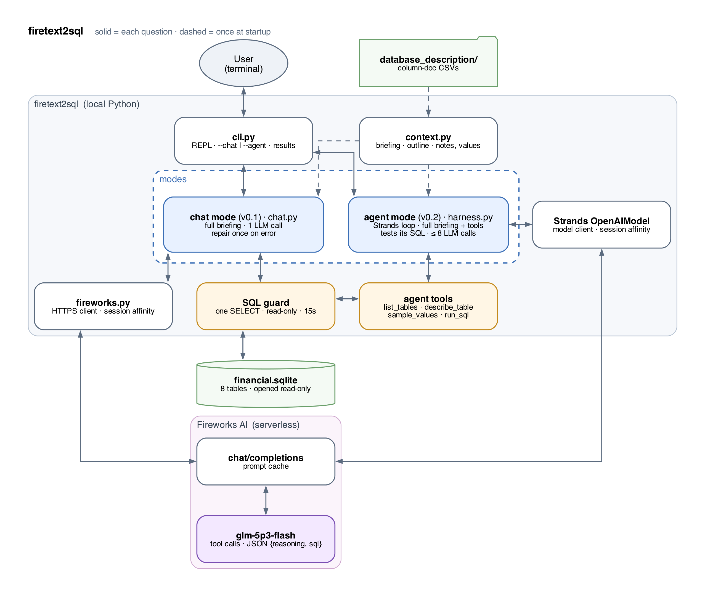

# Text2Sql, with Open Models

## Objective

An accurate, low-latency, low-cost text-to-SQL CLI built on open models served by Fireworks AI.

## How it works



You type a question in plain English, and the CLI turns it into SQL, runs it read-only on the database, and shows the query and the results. Follow-up questions build on the conversation. It's a proof of concept that open models on Fireworks beat a naive baseline prompt (`Convert this question to SQL: {question}`) on quality and reliability, under 3s P50 end to end. The sample database is `financial.sqlite`, a Czech retail bank with 8 tables from the BIRD benchmark.

Both modes share a briefing built once at startup (schema, column notes from `data/database_description/`, and the real stored values of coded columns such as `'POPLATEK TYDNE'` = weekly), a read-only database with a SQL guard, and a 15s query limit. Each version is a mode:

1. **`chat` (v0.1).** One Fireworks call with the full briefing, the last 3 turns and the question, answered as `{reasoning, sql}`. If the SQL fails, the error goes back to the model once.
2. **`agent` (v0.2).** A [Strands Agents](https://strandsagents.com) ([GitHub](https://github.com/strands-agents/harness-sdk)) agent with a compact schema outline and read-only tools: list tables, describe a table, sample values, and test a query. It explores what it needs, tests its SQL, then answers as `{reasoning, sql}`, and the CLI runs that query. Follow-up questions also see the previous result's rows.

## Docs

2. [docs/solution.md](docs/solution.md) — How it works (one architecture diagram for both modes), how the Fireworks platform is used, evaluation method, latency and cost levers, fine-tuning roadmap, and a BIRD benchmark appendix
3. [docs/tradeoffs.md](docs/tradeoffs.md) — Answers to the main design questions: error repair, schema grounding, architectures, open vs. proprietary models, follow-ups, latency/cost, fine-tuning
4. [docs/reports.md](docs/reports.md) — Eval runs and key metrics (accuracy, latency, cost) per version
5. [docs/findings.md](docs/findings.md) — Key findings from the evals, one numbered point each
6. [docs/data.md](docs/data.md) — The `financial` database: table sizes, how the tables join, coded values and gotchas

## Prerequisites

1. [uv](https://github.com/astral-sh/uv) (it installs Python 3.11+ if needed)
2. `curl`, `unzip`, `sqlite3`, and `shasum` or `sha256sum` (used by `setup.sh`)
3. A Fireworks AI API key

## Setup

```bash
./setup.sh
```

This downloads the BIRD dev bundle, verifies its checksum, installs `data/financial.sqlite` and `data/database_description/`, and runs `uv sync` to create `.venv`.

## Environment variables

1. `FIREWORKS_API_KEY` (required) — Fireworks API key
2. `FIREWORKS_MODEL` (optional, default `accounts/fireworks/models/glm-5p3-flash`) — Any Fireworks chat model ID
3. `FIREWORKS_MODE` (optional, default `chat`) — `chat` (v0.1) or `agent` (v0.2)

Set them in a `.env` file in the project root, which the CLI loads automatically and git ignores:

```bash
echo 'FIREWORKS_API_KEY=<your-key>' > .env
echo 'FIREWORKS_MODEL=accounts/fireworks/models/glm-5p3-flash' >> .env   # optional; this is the default
echo 'FIREWORKS_MODE=agent' >> .env                                       # optional; default chat
```

or export them in your shell.

## Run

Each version is a mode of the same CLI:

```bash
uv run cli --chat    # v0.1: one model call with the full schema briefing
uv run cli --agent   # v0.2: a Strands agent that tests its SQL before answering
```

or, with the environment activated, `python -m src.cli --agent`. `--model` overrides the model.

To run the eval, which compares the baseline prompt and both modes:

```bash
uv run python -m src.eval --set dev      # 10 given dev questions, about $0.01
uv run python -m src.eval --set golden   # 200 synthetic questions, about $0.12
uv run python -m src.eval --set followup # 15 multi-turn conversations (46 turns), about $0.03
uv run python -m src.eval --set golden --modes agent   # one mode only; other modes' saved results are kept
uv run python -m src.eval --set golden --rescore   # re-grade a saved report locally, no model calls
```

Reading the results:

1. **Terminal:** one line per mode with accuracy, P50/P95 latency, cost per query and tool calls (plus per-turn and whole-conversation scores on the follow-up set).
2. **`eval/report_<set>.json`:** the record per question and mode: SQL, answer, correct or not, error, tokens, cost and timings.
3. **`dev_answers.json`:** chat mode's answers to the 10 dev questions, in the format the brief asks for.
4. **[docs/reports.md](docs/reports.md):** the written summary: success metrics, a scorecard per mode, the dev answers and the version history.

To run the unit tests (offline; they never call the model):

```bash
uv run pytest
```

Inside the CLI:

1. a question — Generates and runs SQL, then shows the query, the results and a stats line: total, model and SQL time, tokens (cached), and model and tool calls in agent mode
2. a follow-up — Builds on the conversation; in agent mode it also sees the previous result's rows
3. `:reset` — Clears the conversation
4. `:help` — Shows help
5. `exit`, `quit`, Ctrl-D — Ends the session

## Code

1. `src/cli.py` — The REPL loop and table rendering
2. `src/chat.py` — Chat mode (v0.1): prompt, one LLM call, guard, run, repair once. Also `Config`, `Turn`, the SQL guard and `make_session` (one interface over both modes)
3. `src/harness.py` — Agent mode (v0.2): the Strands agent, its read-only schema tools, and loop limits
4. `src/context.py` — Builds the briefing from the schema, column docs and sampled values
5. `src/fireworks.py` — A minimal Fireworks chat-completions client (standard library only)
6. `src/eval.py` — Runs the baseline and each mode on the dev, golden or follow-up questions; writes `eval/report_<set>.json` and `dev_answers.json`
7. `src/golden.py` — Generates the synthetic golden set (questions first, then SQL verified by agreement) into `eval/golden_questions.json`
8. `src/utils.py` — Project paths and the database and column-doc helpers
9. `tests/` — Offline unit tests
10. `data/` — The given dataset: the database, column-description CSVs and the 10 dev questions (never modified)
11. `eval/` — The golden question set and eval reports

## License

The code is licensed under the [Apache License 2.0](LICENSE). The `financial` dataset comes from BIRD and has its own terms. See [BIRD_LICENSE.md](BIRD_LICENSE.md).
