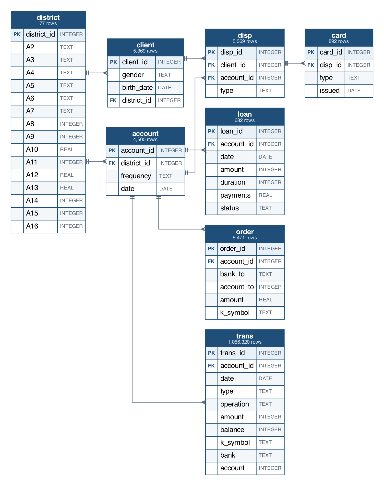

# The financial database

`data/financial.sqlite` is the **financial** database from the [BIRD](https://bird-bench.github.io/) text-to-SQL benchmark, taken from the PKDD'99 Czech retail-bank challenge. Accounts were opened from 1993 through 1997, and transactions run through the end of 1998. The bank is anonymous. The 77 districts are real.

Eight tables. Nearly all of the size is `trans` (1,056,320 rows). Dates in this file are `YYYY-MM-DD`. Many codes are Czech words, not English. BIRD's notes call money amounts US dollars; the source data recorded Czech crowns. Column glosses are in `data/database_description/`, and 10 dev questions are in `data/dev_questions.json`. License: [BIRD_LICENSE.md](../BIRD_LICENSE.md).

## How the tables connect

The bar is the “one” side and the fork is the “many” side. `order` is a reserved word in SQL. Quote it: `"order"`.

## What each table holds

**account** — 4,500 rows. One bank account, opened at a branch in a district, between 1993-01-01 and 1997-12-29. `frequency` is a Czech code: `POPLATEK MESICNE` (monthly, 4,167), `POPLATEK TYDNE` (weekly, 240), or `POPLATEK PO OBRATU` (after each transaction, 93).

**client** — 5,369 rows. A person, with gender (`F` 2,645, `M` 2,724) and birth date. `district_id` is where they live, which can differ from the branch district on their account.

**disp** — 5,369 rows. Links a client to an account. 4,500 rows are `OWNER` (one per account) and 869 are `DISPONENT`. The column notes also mention `USER`, which does not appear in this file. Only an owner can hold a standing order or a loan.

**card** — 892 rows. A card issued to a disposition, not directly to an account. `type` is `classic` (659), `junior` (145), or `gold` (88).

**loan** — 682 rows. One loan on an account: approved amount, duration in months, and the monthly payment. Approved from 1993-07-05 to 1998-12-08. `status` is `A` finished and paid (203), `B` finished and unpaid (31), `C` running and OK (403), or `D` running and in debt (45).

**order** — 6,471 rows. A standing payment from an account to another bank and account. `bank_to` is a two-letter bank code. `k_symbol` is the purpose: `SIPO` household (3,502), `UVER` loan (717), `POJISTNE` insurance (532), `LEASING` (341), or blank (1,379).

**trans** — 1,056,320 rows. Every movement on an account from 1993-01-01 to 1998-12-31. `balance` is the balance after that transaction. `operation`, `k_symbol`, `bank`, and `account` are often null; `bank` and `account` name the partner on a transfer. `type` is `VYDAJ` withdrawal (634,571), `PRIJEM` credit (405,083), or `VYBER` cash withdrawal (16,666) — the column notes list only the first two. `operation` is `VYBER` cash withdrawal (434,918), `PREVOD NA UCET` remittance to another bank (208,283), null (183,114), `VKLAD` cash deposit (156,743), `PREVOD Z UCTU` collection from another bank (65,226), or `VYBER KARTOU` card withdrawal (8,036). `k_symbol` is often empty; when set it is `UROK` interest, `SLUZBY` statement fee, `SIPO` household, `DUCHOD` pension, `POJISTNE` insurance, `UVER` loan payment, or `SANKC. UROK` sanction interest.

**district** — 77 rows. One Czech district. `A2` is the name (`Hl.m. Praha` for Prague) and `A3` is the region: Prague (1), central Bohemia (12), east Bohemia (11), north Bohemia (10), west Bohemia (10), south Bohemia (8), north Moravia (11), south Moravia (14). `A4`–`A16` are 1995–1996 demographics (population, municipalities by size, urban share, salary, unemployment, entrepreneurs, crime). `A4`–`A7` are stored as TEXT even though they are counts. `A9` is unused. `A12` and `A15` are nullable.
