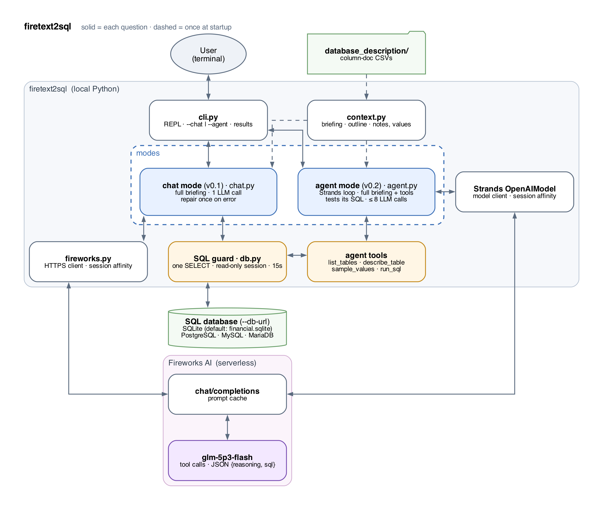

# Solution: FireSQL, a Text-to-SQL Agent

## Objective

An accurate, low-latency, low-cost text-to-SQL CLI built on open models served by Fireworks AI.

## How it works

Each version is a mode of the same CLI: `uv run cli --chat` or `uv run cli --agent`. Both modes share the CLI, the briefing from `context.py`, the SQL guard, the read-only database and the Fireworks model. Every answer shows its own timings and token counts. The diagram source is [architecture.dot](architecture.dot); re-render with `dot -Tpng -Gdpi=200 docs/architecture.dot -o docs/architecture.png`.

### Chat mode (v0.1)

At startup, `context.py` builds a full briefing of every table and column, the column notes, and the real values of coded columns, so the model writes `'POPLATEK TYDNE'` rather than inventing `'weekly'`. For each question, `chat.py` sends that cached briefing, the last 3 turns and the question in one Fireworks call. It gets back `{reasoning, sql}`, checks that the SQL is a single read-only `SELECT`, runs it with a 15s limit, and retries once with the error if it fails. **Results:** 86% on 200 golden questions and 10/10 on dev, against 4% for a naive baseline prompt, at a 0.98s P50 and about $3.60 a day at 30,000 queries. This is the default mode. Details are in [reports.md](reports.md#scorecard-version-02).

### Agent mode (v0.2)

`agent.py` runs a [Strands Agents](https://strandsagents.com) ([GitHub](https://github.com/strands-agents/harness-sdk)) agent on the same Fireworks model. Its cached prompt holds the full briefing while the schema fits (under 40k characters), and a compact outline otherwise. For each question it writes the query, tests it once with `run_sql`, and calls `describe_table` or `sample_values` only when something it needs isn't shown. A rule stops it adding conditions or columns the question didn't ask for. It then answers with `{reasoning, sql}`, which `agent.py` guards and runs itself. Each question gets at most 8 model calls, and the agent keeps the conversation until `:reset`. A follow-up question also carries the previous result's rows (up to 10), so "the third one" or "that year" resolves to the value the user saw. **Results:** 90% on the golden set (chat: 86%) and 46/46 follow-up turns (chat: 44/46), at a 1.85s P50 and about $8.60 a day, with about 2 tool calls per question. It is the most accurate mode, and the base for databases too large for one prompt. Details are in [reports.md](reports.md#scorecard-version-02).

**Design decisions:**

1. **Grounding beats model size.** Accuracy comes from context: schema, column meanings and real stored values. It sits in the cached prompt while it fits, and the agent fetches it by tool once it doesn't.
2. **Verify by execution, within a budget.** The agent tests its query before answering. Caps bound the worst case: one repair in chat, 8 model calls in agent mode, 15s per query.
3. **The model proposes; code executes.** The model only returns `{reasoning, sql}`. The CLI allows a single read-only `SELECT` and runs it itself. If a message isn't a question about the data, the model returns no query and the CLI says so, rather than re-running the previous one.
4. **Conversation includes results.** Follow-ups carry the previous result's rows, so "the third one" means what the user saw.
5. **Fast and cheap by design.** Few model calls (one in chat), a stable prompt prefix that is 96–97% cached, low reasoning effort, and the schema scanned once at startup.
6. **One interface over every mode.** Chat and agent sit behind `make_session`, shared by the CLI, the eval and a future router.
7. **Any SQL database, read-only.** `db.py` connects through SQLAlchemy (`--db-url`). SQLite, PostgreSQL, MySQL and MariaDB sessions are read-only with a query time limit; other dialects get a warning to use a `SELECT`-only user.

What I learned getting here, from schema grounding to the agent-loop changes that took the agent from 82% to 90%, is in [findings.md](findings.md).

## Fireworks platform

Everything runs on [Fireworks AI](https://fireworks.ai) serverless inference, through its OpenAI-compatible endpoint (`https://api.fireworks.ai/inference/v1`).

1. **CLI and evals:** `glm-5p3-flash` ($0.15 input, $0.03 cached, $0.50 output per 1M tokens). Chat mode calls it with `src/fireworks.py`, a standard-library client. Agent mode calls it through Strands' `OpenAIModel`, pointed at the same endpoint, using Fireworks tool calling.
2. **Structured output:** both modes request JSON-schema output, so every reply is `{reasoning, sql}`; `reasoning_effort="low"` keeps output short.
3. **Prompt caching:** the briefing is a fixed prefix, and an `x-session-affinity` header per database and mode keeps parallel sessions on one warm replica. 96–97% of input tokens are served from cache at a fifth of the input price.
4. **Golden set:** `src/golden.py` used `kimi-k3` ($3 / $15 per 1M) as the teacher to write 289 questions and two or three SQL samples each; it cost about $11. The default teacher is now `glm-5p3-flash`.
5. **Evals:** a full run of every mode on all three sets is about 1,000 calls and costs about $0.15. At 8 parallel workers the agent's extra requests hit serverless throttling bursts, so the agent runs with 4.
6. **Next on Fireworks:** a dedicated deployment if the P95 needs to hold under load, and LoRA fine-tuning (see [Appendix A](#appendix-a-fine-tuning-roadmap)).

## Evaluation

**Question sets.**

1. **Dev (10, from BIRD).** `data/dev_questions_with_answers.json`, three tiers, each with gold SQL and the expected result. I run every gold query first to confirm the answer key.
2. **Golden (200, synthetic).** `eval/golden_questions.json`, generated by `golden.py` with `kimi-k3`. The teacher first wrote questions from the briefing, with no SQL. It then wrote SQL for each question two or three times, and a question was kept only if the queries ran and agreed. Ambiguous questions disagree, so they drop out. Questions close to the dev set were removed, so the two sets don't overlap. Tiers come from the gold SQL by a fixed rule.
3. **Follow-ups (15 conversations, 46 turns, hand-written).** `eval/followup_questions.json`. Each conversation has 3–4 turns at medium level (refine a filter, add a split) or complex level (refer to an earlier result: "those five districts", "the third one", "that year"). Every gold query was run and checked for ties. Each conversation runs in one session with the model's own earlier answers as history, as in the CLI. I score every turn, and whole conversations.

**Metric: execution accuracy (as in BIRD).** I compare results, not query text. A prediction is correct when its rows match the gold query's rows. Column names are ignored. Row order is ignored unless the gold query sorts its final result (an `ORDER BY` outside any subquery), and even then tied rows may come in any order. Numbers are rounded before comparing. A query that errors counts as wrong.

**Success metrics.** Each target is my bar for a usable interactive product. Scores per mode are in [reports.md](reports.md#scorecard-version-03-latest-run).

| Dimension | Metric | Target | Why |
|---|---|---|---|
| Accuracy | Execution accuracy on the 200-question golden set | ≥ 85%, far above the naive prompt | Wrong SQL is the main failure of naive text-to-SQL |
| Follow-ups | Turns correct, and conversations with every turn correct (15 conversations, 46 turns) | ≥ 90% of turns, ≥ 80% of conversations | One wrong turn derails the rest of a conversation |
| Latency | End-to-end P50 and P95 per question | P50 < 3s, P95 < 5s | Interactive use |
| Cost | Cost per day at 30,000 queries | ≤ $15 a day, at least 7× under GPT-5.5 ($105–424) | Proprietary-model unit economics don't work at this volume |
| Reliability | Questions with no runnable SQL | ≤ 1% | The user always gets a query or a clear error |

**Modes compared, on the same questions:**

1. **baseline:** a naive one-line prompt, `Convert this question to SQL: {question}`, with no schema;
2. **chat** (v0.1);
3. **agent** (v0.2);
4. **agent-no-rows:** agent mode without the previous result's rows, on the follow-up set only.

For each mode I report accuracy (overall and per tier), P50/P95 latency, tool calls, and cost per query projected to 30k queries a day. Run it with `uv run python -m src.eval --set dev|golden|followup`; add `--rescore` to re-grade a saved report locally without model calls. Per-question records go to `eval/report_<set>.json`, and the dev answers to `eval/dev_answers.json`.

## Results

Both grounded modes meet every target, where the naive baseline prompt fails at 4%. Chat mode scores 86% on the 200 golden questions, 10/10 on dev and 44/46 follow-up turns, at a 0.98s P50 and about $3.60 a day for 30,000 queries. Agent mode is the most accurate: 90% on golden, 9/10 on dev and 46/46 follow-up turns, at a 1.85s P50 and about $8.60 a day, still more than 12× cheaper than GPT-5.5 on the same prompts. On a PostgreSQL copy of the bank, both modes score 9/10 on dev. Scorecards, per-question dev answers, the reasons for golden misses and the version history are in [reports.md](reports.md).

## Limitations

1. **One schema.** Accuracy is measured only on the Czech bank (8 tables, about 1.1M rows), on SQLite and a PostgreSQL copy. MySQL and MariaDB are unit-tested, not run live. Other dialects get no read-only session or time limit from the CLI.
2. **Scale untested.** I haven't tested hundreds of tables or billion-row tables. Chat needs the whole briefing to fit in the prompt, so large schemas need the agent and schema retrieval.
3. **SQL performance unmeasured.** The eval checks that rows match, not query plans or runtime on complex questions. The 15s limit stops a runaway query but doesn't prevent one.
4. **Wrong SQL that runs.** Chat's SQL ran on every golden question but was wrong on 27 of 200, and the CLI shows those results with no warning.
5. **A model's answer key.** The golden set was written and checked by a model, so 86–90% is agreement with that key, not with analysts.
6. **Run-to-run variance.** Each mode ran once. A re-run moved golden accuracy by about a point and the agent's P95 from 2.8s to 4.6s. The agent's 6-question lead is within that variance. There's no load test yet.
7. **Depends on column notes.** Without `--docs-dir` notes or database comments, the model sees coded values but not what they mean.

All of this needs testing on real production databases, against an analyst-written golden set, with analysts reviewing the SQL.

## Next steps

In order, each step gated by the eval:

1. **Analyst golden set and review.** Replace the model-written answer key with 100–200 real questions and SQL written by the database owner's analysts, and have them review a sample of the CLI's answers for correctness and query cost. This turns "good enough to ship" into a number. It runs through the same harness and metric as today ([Evaluation](#evaluation)).
2. **Onboard real databases.** Connect two or three design-partner databases with `--db-url`, draft column notes for their owners to confirm, and run the analyst set on them. This tests the open limitations: large tables, wide schemas and SQL performance on complex questions ([Limitations](#limitations)).
3. **Route per question with the Decider.** Score each question's difficulty, then send easy ones to chat and hard ones to the agent or a stronger model ([Appendix C](#appendix-c-why-add-the-decider-model)).
4. **Fine-tune for production.** Once the CLI is in real use, it can learn from its own verified answers: the model is trained on questions where the right SQL is known, so it makes fewer of the mistakes it makes today. A tuned model ships only if it beats the current one on the analysts' test set. [Appendix A](#appendix-a-fine-tuning-roadmap) explains how.

## Appendix A: Fine-tuning roadmap

**What fine-tuning means here.** Today the model is general-purpose. Everything it knows about a database comes from the briefing the CLI sends with each question. Fine-tuning gives the model extra practice on one database's kind of questions, so it learns their naming, their usual joins and their business terms. It is like training a new analyst on past questions with known answers, rather than handing them the manual every time.

**When it's worth doing.** Not first. Better context took accuracy from 4% to 86–90%, and routing (Appendix C) should cut cost further. Fine-tuning makes sense when the analysts' test set shows the same kinds of mistakes again and again, and better context doesn't fix them. It also makes sense to move to a smaller, faster model that is just as accurate.

**Where the training examples come from.** Each example is a question paired with SQL that is known to be right, because running it returns the correct rows. The first examples come from the same generator that built the 200-question test set. In production, every answer a user accepts or corrects becomes another example, kept separately for each database owner and used only with their consent. The analysts' golden set is never used for training. It stays as the exam, so improvements are measured on questions the model hasn't seen.

**How the training works.** Two stages, both on Fireworks:
1. **Learning by example.** The model studies the question-and-SQL pairs. This uses LoRA, which trains a small add-on to the model instead of retraining the whole thing, so it's fast, cheap and easy to undo.
2. **Learning by trial and reward.** The model writes SQL for practice questions, and the CLI runs each query. It's rewarded when the rows match the right answer and penalised when the query fails, is unsafe or is slow. This is the same test the eval uses, so the model is trained on exactly what it's judged on.

**How a tuned model reaches users.** It must beat the current model on the analysts' golden set, with no slower answers, higher cost or worse follow-ups. It first runs silently alongside the live model on real questions. Then it rolls out to a small share of users, with a one-step switch back if anything regresses. Fireworks can serve many of these small add-ons on one shared model, so each large tenant can have its own tuned version without a separate deployment.

**Keeping it current.** As corrections build up, the add-ons are retrained on a regular schedule. The eval is re-run whenever a schema changes, so a tuned model never drifts out of date without anyone noticing.

## Appendix B: the BIRD benchmark

**Paper:** *Can LLM Already Serve as a Database Interface? A BIg Bench for Large-Scale Database Grounded Text-to-SQLs*, Li et al., NeurIPS 2023 ([arXiv:2305.03111](https://arxiv.org/abs/2305.03111)).

BIRD is a text-to-SQL benchmark: 12,751 question/SQL pairs over 95 real databases from 37 domains, with cryptic column names, coded values, dates stored as text and millions of rows. `financial.sqlite` is one of its databases.

**Main idea.** Correct SQL needs the question, the database (tables, columns, real values), and external knowledge linking words to values, for example "weekly" = `'POPLATEK TYDNE'`. 70% of BIRD's questions need that knowledge of what stored values mean.

**Key findings** (2023 models; use the relative lessons, not the scores):

1. Real databases are much harder than clean ones: models scored 58–83% on Spider but 12–51% on BIRD.
2. External knowledge is the biggest lever. It raised every model by 5–20 points; GPT-4 went from 35% to 55%.
3. Prompting technique beats raw model power. The best score was DIN-SQL with GPT-4, which used sample values, worked examples and self-correction.
4. The best model was far behind humans: 55% against 93%.
5. Of 500 ChatGPT errors, 42% chose the wrong table or column, 41% misread the database (including made-up names), and 18% misused the knowledge hints.
6. Query speed matters too: two correct queries in one example took 22.4s and 4.0s.

**Metrics.** Execution accuracy checks whether the predicted query returns the same rows as the gold query, which is the metric I use. The Valid Efficiency Score adds credit for correct queries that also run fast.

## Appendix C: Why add the Decider model

**The problem.** Sending every question down the same path either overpays or underperforms. On easy questions, chat and agent are equally accurate (93%), so the agent's extra cost and time buy nothing. On hard questions, the agent is clearly better, and a stronger model may be worth its price.

**The fix.** Before answering, a small, fast model ([Strands Decider](https://strandsagents.com/docs/labs/strands-decider/overview/), open source) rates each question as easy, medium or hard. Easy questions go to fast chat, medium ones to the agent, and the hardest to the agent on a stronger model. It never writes SQL; it only picks the path.

**The business outcome (estimate).**
- **Lower cost:** about $6.70 a day instead of $8.56 for agent-level accuracy (about 89% against 90%), roughly 20% less. The saving grows with every cohort.
- **Faster answers:** about 37% of questions get chat's 1-second response.
- **Better answers where it matters:** extra spend goes only to the hard questions, where errors cost the most trust.

**How it gets proven.** These numbers assume the Decider always rates questions correctly. A pilot run on the analysts' golden set measures how often it does, then compares accuracy, speed and cost against chat and agent before it ships.

**How, in one line.** A new `routed` mode beside chat and agent, with the Decider as a small service next to the CLI. It falls back to chat if the service is down, so nothing breaks.
